  
  
  

### 🧸 → 💻 &nbsp;From the classroom to the codebase

I spent years making hard ideas simple for five-year-olds. Now I do the same with code: software that is **clear for every user, kind by default, and backed by data**.

- 🎓 Master of Software Engineering — Universiti Putra Malaysia (2026)
- 🎓 BSc Computer Science — University of the People
- 🍎 Kindergarten teacher · former ICT teacher
- 🔎 Open to **software engineering, UI/UX and EdTech** roles in Malaysia or remote

### 🎨 Two toolboxes

| Classroom | Where they meet | Code |
|:--|:--:|--:|
| Early childhood development · Phonics · Play-based learning · Lesson design · Mentoring | **UI/UX · Project management · EdTech · Communication** | Python · NLP · Sentiment analysis · Laravel · Git · HTML/CSS/JS |

  
  
  
  
  
  
  

### 🧩 Projects

| | |
|:--|:--|
| 💬 **MyDigital ID — User Feedback Sentiment Analysis** | Compared TextBlob, VADER and SentiWordNet, and evaluated SVM, Decision Tree and Naive Bayes on real user reviews. |
| 🧩 **[Portfolio](https://shatha-gif.github.io)** · [code](https://github.com/shatha-gif/shatha-gif.github.io) | A playful portfolio where early-childhood design meets software engineering. |

### 🏅 Recent certificates
`Git 101: Hands-On Git & GitHub` · `AI-Powered Python with AI & APIs` · `Getting Started with Laravel` — CODEVERSE, UTHM (2026)

Made with crayons &amp; code ✏️

